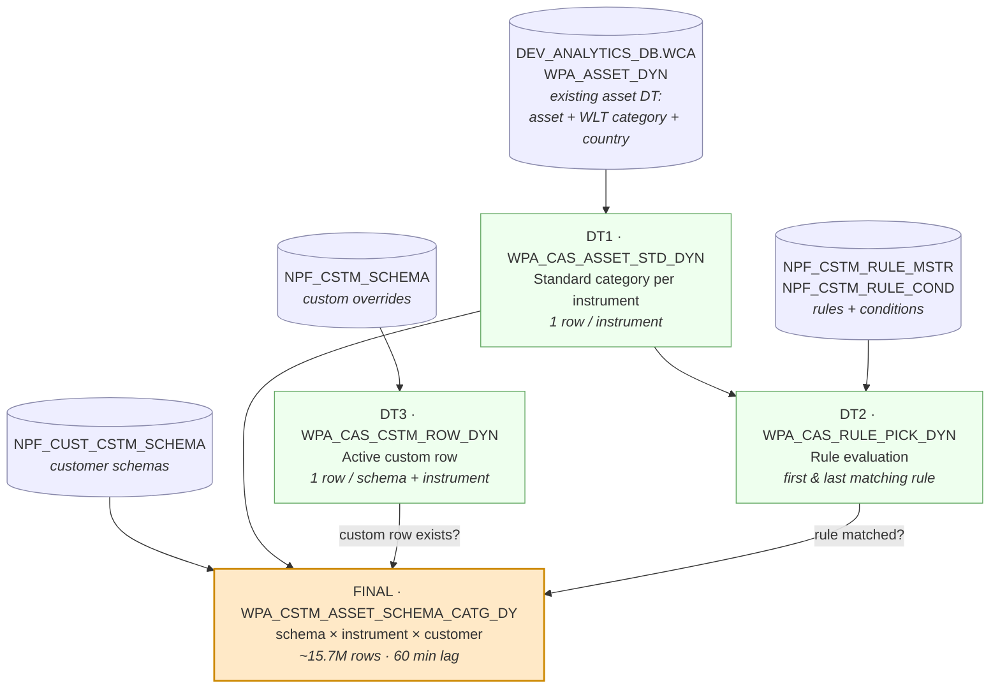
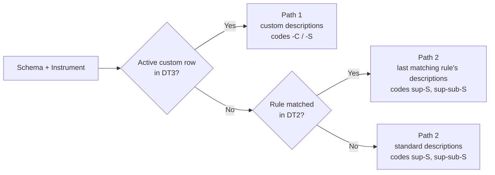

# Proposal: WPA_CSTM_ASSET_SCHEMA_CATG as Snowflake Dynamic Tables

**Goal:** replace the current Streams + Task + 2 Stored Procedures with a chain of **4 Dynamic Tables** that reproduce the Oracle logic (`npf_common_pkg.npf_asst_typ_mgr` + `RULE_EVALUATION`). Snowflake keeps the chain refreshed automatically.

---

## 1. Flow diagram



**Plain-text version** (for viewers without Mermaid):

```
 SOURCES                                   DYNAMIC TABLES
 ───────                                   ──────────────
 WPA_ASSET_DYN (existing asset DT) ──▶ DT1 WPA_CAS_ASSET_STD_DYN ──┬──────────────┐
                                        (standard category)          │              │
                                                                     ▼              │
 NPF_CSTM_RULE_MSTR / _COND ─────────▶ DT2 WPA_CAS_RULE_PICK_DYN    │              │
                                        (rule evaluation)            │              │
                                                                     │              │
 NPF_CSTM_SCHEMA ────────────────────▶ DT3 WPA_CAS_CSTM_ROW_DYN     │              │
                                        (custom override)            │              │
                                              │                      │              │
 NPF_CUST_CSTM_SCHEMA ───────────────────────┼──────────────────────┼──────────────┤
                                              ▼                      ▼              ▼
                              FINAL  WPA_CSTM_ASSET_SCHEMA_CATG_DY
                              every customer schema × every instrument
```

---

## 2. What each table does

| # | Table | Oracle equivalent | What it does | Refresh |
|---|---|---|---|---|
| DT1 | `WPA_CAS_ASSET_STD_DYN` | `npf_asst_typ_mgr` (6-arg) + country lookup | Standard super/sub category and country description per instrument (defaults `30` Other Assets / `20` Miscellaneous). **The only place the asset table is read.** | With downstream |
| DT2 | `WPA_CAS_RULE_PICK_DYN` | `RULE_EVALUATION` | Evaluates each schema's active rules once per distinct (super desc, sub desc, country) combination, not per instrument, and keeps the first and last matching rule. | With downstream |
| DT3 | `WPA_CAS_CSTM_ROW_DYN` | `v_rec_cnt` check + custom cursor | The active custom override (`END_DT IS NULL`) for each schema + instrument. | With downstream |
| FINAL | `WPA_CSTM_ASSET_SCHEMA_CATG_DY` | `npf_asst_typ_mgr` (11-arg) | For every customer schema × instrument: **custom row → custom values**, else **rule match → rule descriptions**, else **standard**. Builds the `-C` / `-S` codes. | Every 60 min |

### Decision per row (same as Oracle)



---

## 3. Current vs proposed

| | Current (Streams + Task + Procs) | Proposed (Dynamic Tables) |
|---|---|---|
| Objects to maintain | 7 streams, 1 task, 2 procedures (~1,400 lines), audit table | 4 dynamic tables (~300 lines of SQL) |
| Change handling | Hand-coded per stream: impacted keys, temp tables, MERGE, deletes | Automatic: Snowflake works out what changed |
| Refresh order | Controller proc checks each stream | Snowflake follows the DT dependency graph |
| Logic | Snowflake port, with some differences from Oracle | Matches Oracle exactly (validated by scenario) |
| Monitoring | Custom audit table | Built-in refresh history and Snowsight graph |
| Failure handling | Task never suspends (`SUSPEND_TASK_AFTER_NUM_FAILURES = 0`) | DT refresh errors visible per table; alerts can be added |

---

## 4. Validation

`Validation - CSTM Asset Schema Catg DY.sql` rebuilds the expected output independently from the base tables. It compares every **schema × instrument × customer** row, column by column, grouped by Oracle scenario (custom-code variants, one rule, several rules, standard, default category, no country).

## 5. Files

| File | Purpose |
|---|---|
| `CSTM Asset Schema Catg DT - Oracle Parity.sql` | DDL for the 4 dynamic tables (DEV) |
| `Validation - CSTM Asset Schema Catg DY.sql` | Scenario-based validation |
| `Oracle_Asset_Type_Manager_Logic.md` | Oracle logic explained, and the mapping to Snowflake |
